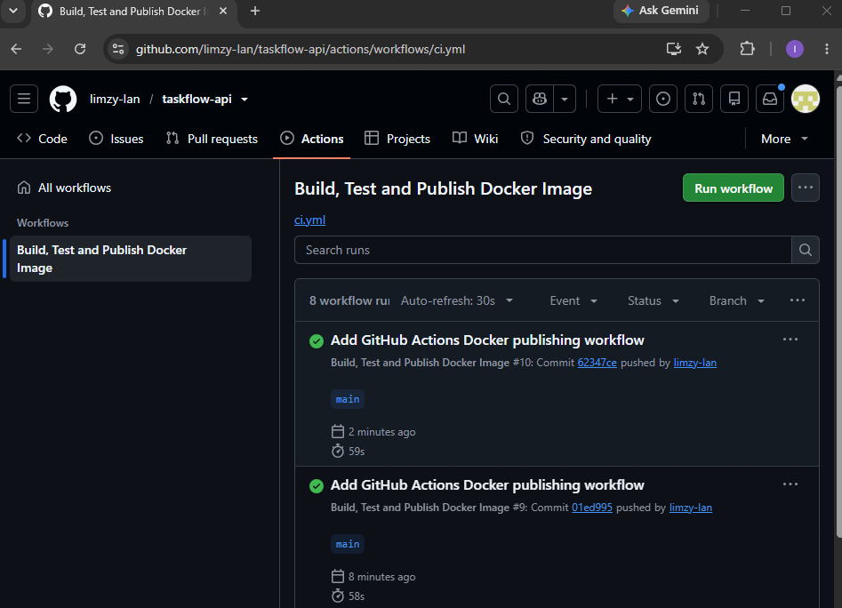
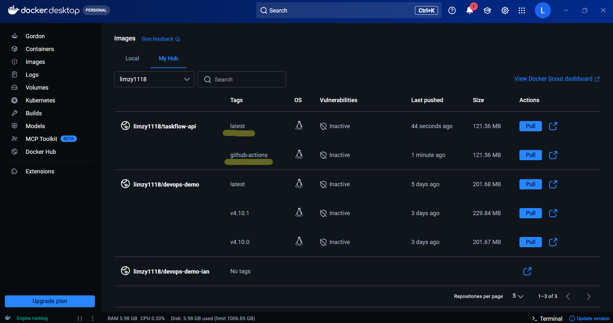
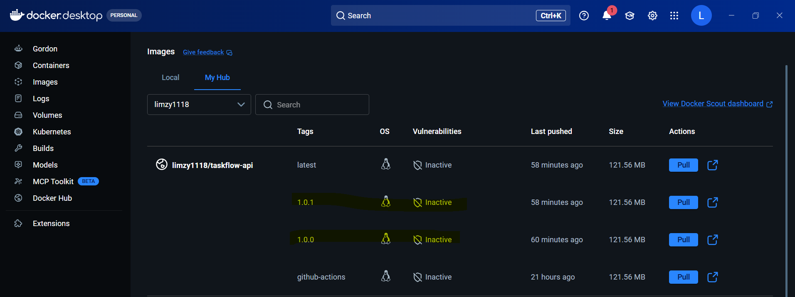
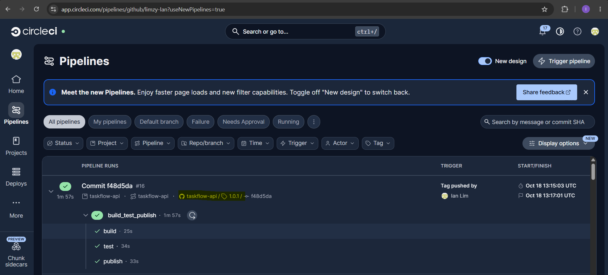

# TaskFlow API

A Spring Boot REST API for managing tasks. The API is deployed on Railway, with a frontend hosted on Netlify and Docker images published through CircleCI and GitHub Actions.

## Live Applications

- **API:** [TaskFlow API on Railway](https://taskflow-api-production-d471.up.railway.app/api/tasks)
- **Frontend:** [TaskFlow on Netlify](https://boisterous-cupcake-3d1b37.netlify.app)

### Railway Deployment


## API Examples

List all tasks:

```bash
curl 'https://taskflow-api-production-d471.up.railway.app/api/tasks'
```

Create a task:

```bash
curl -i -X POST 'https://taskflow-api-production-d471.up.railway.app/api/tasks' \
  -H 'Content-Type: application/json' \
  -d '{"title":"Test Task","description":"Created with curl","priority":"Low","dueDate":"2026-11-30","completed":false}'
```

The create endpoint returns `201 Created` and the new task as JSON. The `dueDate` field uses the `YYYY-MM-DD` format.

## Continuous Integration

CircleCI and GitHub Actions build and publish Docker images to Docker Hub. Railway separately hosts the deployed API.

### CircleCI


### GitHub Actions





## Frontend

The Netlify frontend connects to the Railway API.


## Docker Image Versions

Docker images are tagged with version numbers in addition to `latest`.
Version tags follow Semantic Versioning (`MAJOR.MINOR.PATCH`), with `latest` pointing to the newest image.





The screenshots show the published tags and the CircleCI workflow that creates them.
