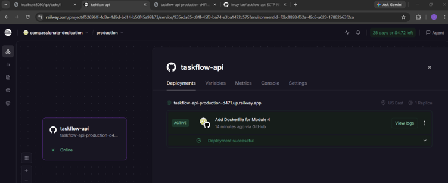
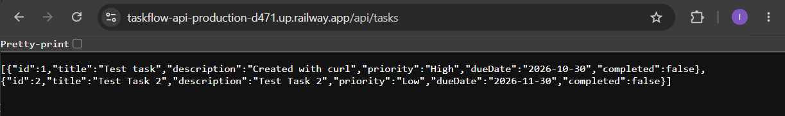
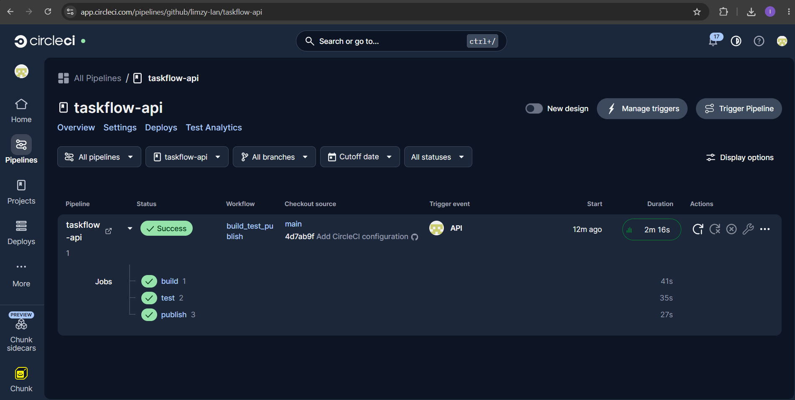
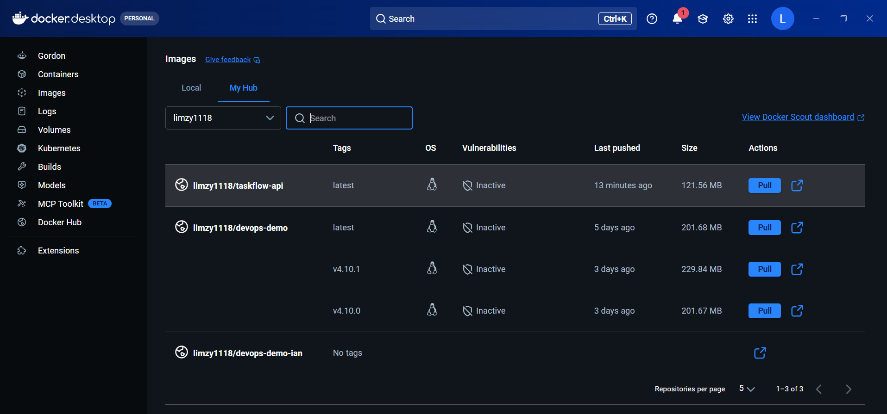
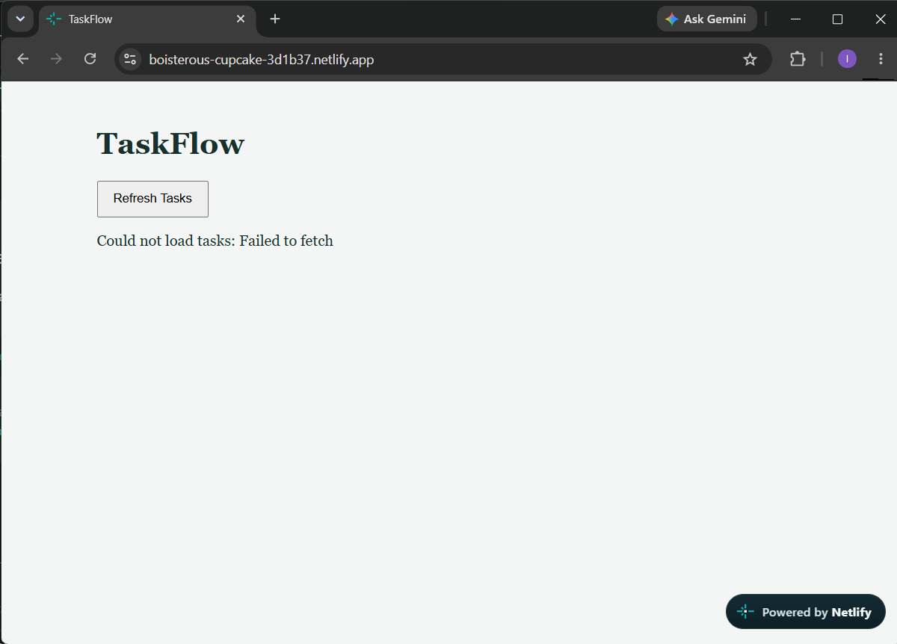

Railway - done

Stretch Goals (Optional)
OPTION 1: ADD A CI PIPELINE
Add a CI pipeline with GitHub Actions or CircleCI that builds, tests and publishes your TaskFlow API
image to Docker Hub on every push to main. You will then have two pipelines working side by side: a CI
pipeline to Docker Hub and a deployment pipeline to Railway.
• Refer to Lesson 4.7 (CircleCI) or Lesson 4.9 (GitHub Actions)
• Store your Docker Hub credentials as secrets - never in your code
• In your README, include a link to a successful pipeline run and your image on Docker Hub

The CI Workflow:
1. Developer writes code
   ↓
2. Developer commits code to Git
   ↓
3. Developer pushes to GitHub
   ↓
4. GitHub notifies CI server (CircleCI)
   ↓
5. CI server pulls code
   ↓
6. CI server builds application
   ↓
7. CI server runs automated tests
   ↓
8. CI server publishes build artifacts (Docker image)
   ↓
9. Developer receives feedback (pass/fail)

I will use CircleCI (from Lesson 4.7) and GitHub Actions (from Lesson 4.9) but other popular CI tools include: GitHub Actions, GitLab CI/CD, Jenkins, Azure DevOps

CircleCI -> DockerHub - Done

GitHub Actions CI/CD but i think i already have circleci configured so cannot have both running simultaneously
GitHub Actions -> DockerHub

OPTION 2: ADD A FRONTEND ON NETLIFY
Create a frontend that uses your TaskFlow API and deploy it to Netlify, with your backend still running
on Railway.
• The frontend should call your Railway API URL (for example, list your tasks)
• Your browser will block requests from the Netlify domain until you allow it in your API: look up CORS in
Spring Boot
• In your README, include your Netlify URL and a screenshot of the frontend showing data from the API

Using GitHub Co-Pilot to guide me as i dont remember much much about Netlifty but i seems to have an account created using lesson.

